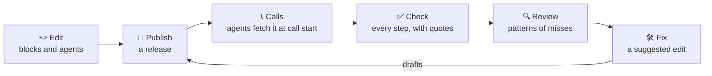

<div align="center">

# 📋🗄️ sopops

**Manage your agents' instructions, serve them when a call starts, and check every call against them.**

Instructions are what your platform may call the prompt or system prompt.

[Quickstart](#quickstart) · [Walkthrough](examples/walkthrough/WALKTHROUGH.md) · [Connect your agent](#connect-your-agent) · [Docs](#docs) · [API](API.md)

</div>

---

Most teams run several voice agents that share most of their instructions: one per restaurant, customer or task. sopops splits those instructions into blocks. Change a block once and every agent that uses it changes on its next call, with no redeploy.

Then every call comes back to sopops and is checked against the procedures it should have followed. Misses are grouped into patterns. Your team reviews each pattern, sopops drafts the fix, and Insights shows whether the next release helped.

<p align="center"></p>

## The loop



1. **Edit** shared instructions, procedures and agents in the browser, or keep them in git. Every save is a draft.
2. **Publish** a release. Agents fetch it when a call starts, or sopops pushes it to the platform. Rolling back is one click.
3. **Check** each call, step by step, against the release it ran on, with the quotes that show it.
4. **Review** the patterns: a real mistake, acceptable, the procedure is wrong, or sopops is wrong.
5. **Fix** with a suggested edit, compiled and shown as a diff of each agent's instructions. Apply it as a draft or a GitHub pull request.

sopops is built on [sopc](https://github.com/amanmibra/sopc), and compiles with the sopc binary, so its output matches the CLI byte for byte.

## Quickstart

```sh
cp .env.example .env        # optional: model keys, sign-in, email
docker compose up --build   # sopops and Postgres on http://127.0.0.1:8484
```

Open http://127.0.0.1:8484 and follow the setup steps. To check calls, set a model ([Models](docs/sessions-and-review.md#models)).

Without Docker, with [sopc](https://github.com/amanmibra/sopc) v0.0.17 or later:

```sh
uv sync && pnpm -C web install && pnpm -C web build
SOPC_BIN=/path/to/sopc uv run sopops   # SQLite in ./sopops.db
```

To see the whole loop first, [the walkthrough](examples/walkthrough/WALKTHROUGH.md) sends 300 synthetic calls with planted failures through it. `just examples/walkthrough/all` runs it in about a minute with fake models, no keys needed.

## Blocks

| Block | What it is |
|---|---|
| Shared instruction | Text several agents get: identity, voice, policy. |
| Procedure | An SOP: when it applies, its steps and tools, never rules, warning signs. |
| Group | A named list of blocks an agent can use as one. |
| Agent | One per voice agent: its own text, its blocks in order, its variables. |
| Release | A snapshot of every agent's full instructions. Agents run the live one. |

Before you publish, **Changes** shows exactly how each agent's instructions will change.

<p align="center"></p>

## Import your agents

Already running agents? On the **Import** page, sopops gives you one command to run in your agents' repo with Claude Code or Codex:

```sh
claude mcp add sopops --env SOPOPS_URL=http://127.0.0.1:8484 --env SOPOPS_TOKEN=sopops_onb_... \
  -- uvx --from 'sopops[mcp] @ git+https://github.com/amanmibra/sopops@main#subdirectory=sdks/python' sopops-mcp \
  && claude "Onboard this project's agents into sopops: call the sopops get_kickoff tool and follow it."
```

Your coding agent finds the instructions wherever they live, splits them into blocks and sends a proposal. Every agent is compared with its original sentence by sentence, so nothing is dropped silently. You review it step by step and apply it as drafts. You can also paste instructions, upload them, read them from ElevenLabs or Vapi, or import a sopc project. [More on importing](docs/import.md).

## Connect your agent

| Platform | Instructions | Calls back to sopops |
|---|---|---|
| **LiveKit** | `attach()` in the Python SDK | `attach()`, with tool calls. Or no code: a LiveKit Cloud webhook. |
| **ElevenLabs** | Pushed on publish, or the call-start webhook | The post-call webhook, no code |
| **Vapi** | Pushed on publish, or the assistant-request webhook | The end-of-call report, no code |
| **Anything else** | `GET /v1/workspaces/{ws}/agents/{agent}` | `POST /v1/workspaces/{ws}/sessions` |

On LiveKit, one call fetches the instructions, records the release and sends the call back when it ends:

```python
from sopops.livekit import attach

async def entrypoint(ctx: JobContext):
    await ctx.connect()
    session = AgentSession(...)
    ins = await attach(ctx, session, fallback=FALLBACK, stream=True)
    await session.start(room=ctx.room, agent=Agent(instructions=ins.text, tools=TOOLS))
```

If sopops is down, `attach` uses the last good copy, then `fallback`, so it never blocks a call. `stream=True` sends each turn while the call runs. Set `SOPOPS_URL` to the workspace's URL and `SOPOPS_TOKEN` to a token from Settings → Access.

Webhooks, the TypeScript SDK and the no-code setup for each platform are in [docs/connect.md](docs/connect.md). A complete agent is in [examples/livekit-restaurant](examples/livekit-restaurant).

## Sessions

A session is one call or chat. The **Sessions** page lists them live, each with its transcript, tool calls and result per procedure. **Insights** tracks the miss rate over time and compares two releases rule by rule. [How checks, patterns and suggestions work](docs/sessions-and-review.md).

## Docs

| | |
|---|---|
| [Import](docs/import.md) | Coding agents, sopc projects, paste and platform import |
| [Connect](docs/connect.md) | SDKs, webhooks, no-code capture, tokens |
| [Sessions and review](docs/sessions-and-review.md) | The check pipeline, patterns, verdicts, suggestions, models and spend |
| [Configuration](docs/configuration.md) | Every environment variable |
| [Sign in](docs/sign-in.md) | Passwords, teams and join links, GitHub, Google, email |
| [Git](docs/git.md) | Keeping instructions in a repo, and two-way GitHub sync |
| [API.md](API.md) | Every endpoint. The OpenAPI spec is at `/openapi.json`. |

## Status

sopops is v0. Without sign-in, anyone who can reach it can change everything except what tokens guard, so run it on a private network or set `SOPOPS_AUTH_REQUIRED=true` ([Sign in](docs/sign-in.md)).

Coming next: runtime enforcement (checking steps during a call and nudging the agent), A/B tests, Retell, an OpenTelemetry receiver, SAML SSO.

## Development

FastAPI, SQLModel and Alembic in `src/sopops_server`. Vite, React, TanStack and shadcn/ui in `web/`. In production, one process serves both. Setup, layout and conventions are in [CONTRIBUTING.md](CONTRIBUTING.md).

## License

Apache-2.0
